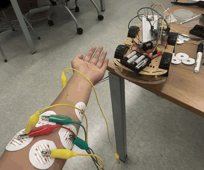

## Muscle signals control an RC car

When the hand closes, electrodes on the forearm pick up the muscle signal that controls the car. I also [adapted the sensing circuit](https://github.com/charleskim990819/Biopotential-EXG-sPCB) for a stretchable board using liquid-metal traces.

[Full video (21 s, MP4)](https://raw.githubusercontent.com/charleskim990819/Biopotential-EXG-sPCB/master/images/operating%20RC%20car%20with%20EXG.mp4) · [Circuit and mask files](https://github.com/charleskim990819/Biopotential-EXG-sPCB/tree/master/hardware)

## Selected work

I’m an integrated M.S./Ph.D. student in Electrical and Electronic Engineering at Yonsei University’s BLISS Lab. I make inks for stretchable circuits and instruments for wearable sensors.

- **Liquid metal inks.** I developed a water-based ink that conducts as it dries. We used it to print a circuit that lights four LEDs on the back of a hand. [Ink chemistry](https://www.charleskim99.com/projects/1_project/) · [On-skin circuit](https://www.charleskim99.com/projects/2_project/)
- **STK RevM20 sensor front end.** I designed a flexible board to measure three currents and pH simultaneously. [Hardware design](https://www.charleskim99.com/projects/stk-revm20/) · [Engineering records](https://github.com/charleskim990819/charleskim990819.github.io/tree/main/docs/projects/stk-revm20)

[All projects](https://www.charleskim99.com/projects/) · [CV](https://www.charleskim99.com/cv/) · [LinkedIn](https://www.linkedin.com/in/charleskim99/)
